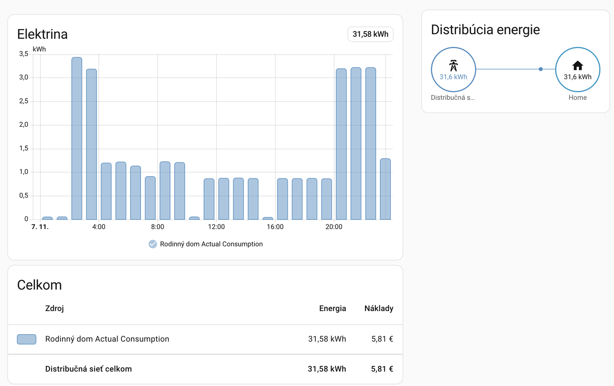
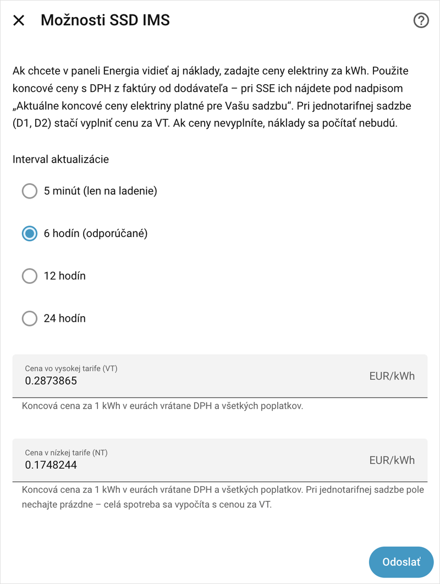
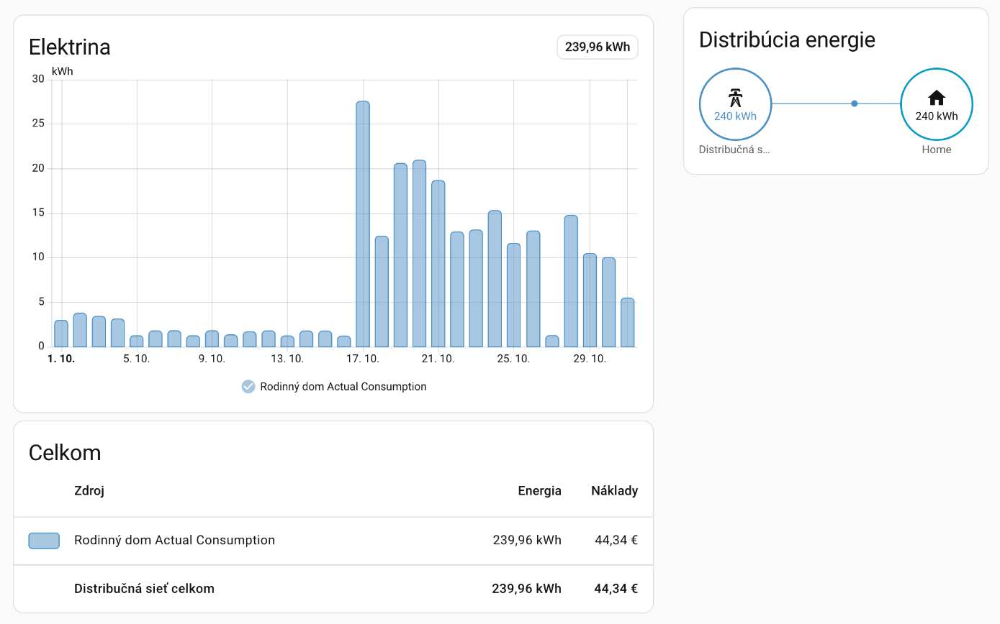
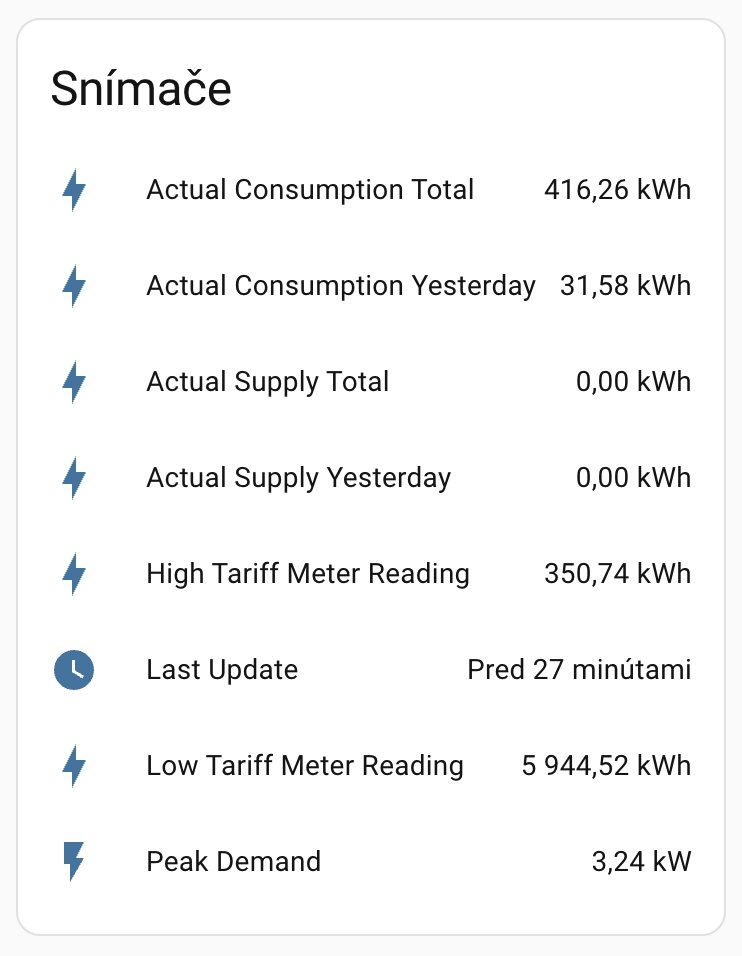

# Stredoslovenská distribučná (SSD IMS) pre Home Assistant

[](https://github.com/baracudaz/ssd-ims/releases/latest)
[](#inštalácia)
[](https://github.com/baracudaz/ssd-ims/actions/workflows/lint.yml)
[](https://github.com/baracudaz/ssd-ims/actions/workflows/validate.yml)
[](LICENSE)

*English: a Home Assistant integration for the SSD energy data portal (ims.ssd.sk). User documentation is in Slovak; developer documentation is in English in [DEVELOPMENT.md](DEVELOPMENT.md).*

Integrácia sťahuje údaje o spotrebe a dodávke elektriny z Portálu energetických dát <https://ims.ssd.sk> a ukladá ich do Home Assistantu, kde ich zobrazí panel Energie — po hodinách, s históriou a voliteľne aj s nákladmi v eurách.



## Funkcie

- Hodinová spotreba a dodávka do siete v paneli Energie, s históriou až 365 dní dozadu
- Náklady v eurách podľa vašich cien za vysokú (VT) a nízku tarifu (NT)
- Mesačné stavy registrov VT/NT a maximálny výkon z elektromera
- Viac odberných miest naraz, každé s vlastným názvom

Portál zverejňuje údaje raz denne po polnoci, najnovšie údaje sú preto vždy za včerajšok.

## Inštalácia

Od verzie 2026.11 je HACS súčasťou Home Assistantu ako **Marketplace**:

1. Otvorte **Nastavenia** → **Marketplace**
2. Vyhľadajte „Stredoslovenská distribučná (SSD IMS)“ a zvoľte **Inštalovať**
3. Ak Home Assistant potrebuje reštart, ponúkne ho v časti **Opravy**

Ak ste integráciu nainštalovali cez HACS pred verziou 2026.11, nemusíte nič robiť — Marketplace ju prevezme a aktualizácie sa budú zobrazovať v časti **Nastavenia** → **Aktualizácie**.

<details>
<summary>Home Assistant starší ako 2026.11 (HACS) a ručná inštalácia</summary>

**HACS:** otvorte HACS → **Integrations** → **+**, vyhľadajte „Stredoslovenská distribučná (SSD IMS)“, zvoľte **Install** a reštartujte Home Assistant.

**Ručne:** skopírujte priečinok `custom_components/ssd_ims` z tohto repozitára do `config/custom_components/` a reštartujte Home Assistant.

</details>

### Prechod na verziu 2.3.0

Nič netreba robiť: štatistiky, entity aj nastavenia zostanú a nové entity registrov sa pridajú samé. Ak chcete vidieť náklady, postupujte podľa časti [Náklady](#náklady).

## Nastavenie

1. Otvorte **Nastavenia** → **Zariadenia a služby** → **Pridať integráciu** a vyhľadajte „Stredoslovenská distribučná (SSD IMS)“
2. Zadajte meno a heslo do portálu <https://ims.ssd.sk>
3. Vyberte odberné miesta — sú označené EIC kódom odberného miesta, ktorý nájdete na faktúre
4. Pomenujte ich, napr. adresou alebo názvom bytu
5. Zvoľte interval aktualizácie (odporúčaných 6 hodín) a koľko dní histórie načítať (predvolene 7, najviac 365)

Názov odberného miesta sa stane súčasťou ID jeho štatistík. Ak ho neskôr zmeníte cez **Rekonfigurácia**, začne sa nová séria a doterajšia história sa v paneli Energie neprenesie.

## Panel Energie

1. Otvorte **Nastavenia** → **Panely** → **Energie**
2. V časti **Elektrická sieť** zvoľte **Pridať sieťové pripojenie**
3. V poli **Energia dovážaná zo siete** zvoľte `ssd_ims:<názov>_actual_consumption`
4. Ak dodávate elektrinu do siete (napr. z fotovoltiky), v poli **Energia vyvážaná do siete** zvoľte `ssd_ims:<názov>_actual_supply`

## Náklady

Home Assistant neuplatní cenu z panela Energie na údaje importované touto integráciou, preto náklady počíta integrácia sama:

1. V **Nastavenia** → **Zariadenia a služby** → **Stredoslovenská distribučná (SSD IMS)** → **Konfigurovať** zadajte ceny za 1 kWh. Pri jednotarifnej sadzbe (D1, D2) stačí cena VT.
2. V nastaveniach panela Energie upravte pripojenie k sieti a v časti **Sledovanie nákladov** zvoľte **Použiť entitu sledujúcu celkové náklady** → `ssd_ims:<názov>_actual_consumption_cost`.
3. V nastaveniach domácnosti si nastavte menu **EUR**.

Ak ste zákazníkom SSE, ceny nemusíte zadávať ručne: integrácia [SSE eZóna](https://github.com/baracudaz/sse-ezona) ich preberá z portálu dodávateľa vrátane energopomoci a SSD IMS ich pre odberné miesto s rovnakým EIC kódom použije automaticky namiesto cien z možností. Každú hodinu ocení cenou, ktorá v tej hodine platila, takže zmena ceny sa prejaví až od svojej hodiny a staršie náklady nezmení. Krok 2 a 3 platia aj vtedy.



**Kde nájdete ceny:** na faktúre od dodávateľa — SSE ich uvádza pod nadpisom *Aktuálne koncové ceny elektriny platné pre Vašu sadzbu*. Tieto koncové ceny už obsahujú silovú elektrinu, distribúciu, poplatky aj DPH, položky faktúry preto nesčítavajte sami. Mesačné poplatky (napr. za istič) v nákladoch nie sú.

**Majte na pamäti:** pri cenách z možností integrácia pozná len cenu, ktorú práve zadáte. Pri prvom zadaní cien sa ňou ocení celá importovaná história, hoci v minulých rokoch boli ceny iné — staršie náklady sú preto len orientačné. Neskoršia zmena ceny prepočíta len zhruba posledné dva mesiace, staršie obdobia si ponechajú pôvodnú cenu.



<details>
<summary>Ako sa náklady počítajú</summary>

Elektromer rozdeľuje spotrebu na VT a NT len v mesačných odpočtoch registrov; kedy HDO prepínalo tarify, portál nezverejňuje. Každá hodina sa preto ocení priemernou cenou svojho obdobia, váženou pomerom VT/NT v tomto období. Mesačné náklady sú tak presné, rozdelenie na hodiny je priemer. Hodiny po poslednom odpočte sa ocenia pomerom predchádzajúceho obdobia a po zverejnení odpočtu sa samy opravia.

Uložením možností sa nové ceny uplatnia hneď. Pri cenách z možností hodinové náklady sa novou cenou prepočítajú za posledné tri obdobia registrov (zhruba dva mesiace a aktuálny mesiac), staršie hodiny si ponechajú pôvodnú cenu. Pri cenách z integrácie SSE eZóna sa použije história ceny, ktorú si Home Assistant ukladá v dlhodobých štatistikách; hodiny pred jej začiatkom sa ocenia prvou známou cenou. Náklady existujú len pre hodiny, ktorých spotreba bola importovaná.

</details>

## Entity a štatistiky

Každé odberné miesto je samostatné zariadenie. Jeho EIC kód nájdete na stránke zariadenia v karte **Informácie o zariadení** ako **Sériové číslo**.



<details>
<summary>Zoznam entít a štatistík</summary>

| Entita | Popis |
|--------|-------|
| `sensor.<názov>_actual_consumption_yesterday` | Spotreba za včerajšok (kWh) |
| `sensor.<názov>_actual_supply_yesterday` | Dodávka do siete za včerajšok (kWh) |
| `sensor.<názov>_actual_consumption_total` | Celková spotreba (kWh) |
| `sensor.<názov>_actual_supply_total` | Celková dodávka do siete (kWh) |
| `sensor.<názov>_high_tariff_meter_reading` | Posledný mesačný stav registra VT, 1.8.1 (kWh) |
| `sensor.<názov>_low_tariff_meter_reading` | Posledný mesačný stav registra NT, 1.8.2 (kWh) |
| `sensor.<názov>_peak_demand` | Maximálny štvrťhodinový výkon za posledné obdobie, 1.6.0 (kW) |
| `sensor.<názov>_last_update` | Čas poslednej aktualizácie |

Entity registrov majú atribúty `reading_time` (čas odpočtu) a `meter_serial_number` (výrobné číslo elektromera).

| Štatistika | Popis |
|------------|-------|
| `ssd_ims:<názov>_actual_consumption` | Spotreba po hodinách (kWh) |
| `ssd_ims:<názov>_actual_supply` | Dodávka do siete po hodinách (kWh) |
| `ssd_ims:<názov>_actual_consumption_cost` | Náklady na spotrebu po hodinách (EUR), ak je zadaná cena |
| `ssd_ims:<názov>_consumption_vt` / `_consumption_nt` | Spotreba vo VT / NT po mesiacoch (kWh) |
| `ssd_ims:<názov>_cost_vt` / `_cost_nt` | Náklady vo VT / NT po mesiacoch (EUR), ak je zadaná cena |

Štatistiky VT/NT sú rozdiely medzi mesačnými odpočtami registrov a zapisujú sa do poslednej hodiny mesiaca, takže v dennom pohľade sa zobrazia ako jeden blok na konci mesiaca. Načíta sa celá história registrov, ktorú portál má; cez výmenu elektromera sa rozdiel nepočíta. Ak chcete v paneli Energie rozdelenie VT/NT namiesto hodinovej spotreby, použite ich **namiesto** `actual_consumption`, nie spolu s ňou — tá istá energia by sa započítala dvakrát.

</details>

## Riešenie problémov

- **Prihlásenie zlyhalo:** overte meno a heslo na <https://ims.ssd.sk>. Ak sa heslo zmenilo, Home Assistant ponúkne opätovné prihlásenie.
- **Panel Energie je prázdny:** počkajte na prvú aktualizáciu a overte, či máte v paneli zvolené správne štatistiky. Dnešné údaje portál ešte nemá.
- **Import pozastavený (Opravy):** ak portál vráti neplatné, prázdne alebo neúplné údaje za uzavretý deň (nie včerajšok, ktorý ešte môže dorážať), integrácia ich nezapíše a novšie dni neimportuje, aby v súčte nevznikla medzera. V **Nastavenia** → **Systém** → **Opravy** uvidíte upozornenie s dôvodom. Skontrolujte údaje na portáli a kliknite **Importovať znova**, alebo použite akciu `ssd_ims.reimport_statistics` (voliteľne s dátumom dňa). Explicitný dátum prepíše ten deň a všetky novšie dni až po včerajšok; plánované obnovenie uzavreté dni neprepíše. Ďalšie plánované obnovenie zablokovaný deň skúsi aj samo; po úspešnom dni upozornenie zmizne.
- **Chyba certifikátu SSL:** aktualizujte certifikáty certifikačných autorít vo vašom systéme.

Podrobné protokolovanie zapnete v `configuration.yaml`:

```yaml
logger:
  logs:
    custom_components.ssd_ims: debug
```

Ak problém nahlasujete, pripojte diagnostické údaje (**Nastavenia** → **Zariadenia a služby** → integrácia → ⋮ → **Stiahnuť diagnostické údaje**). Neobsahujú prihlasovacie údaje ani EIC kódy odberných miest.

## O projekte

Licencia AGPLv3, pozri [LICENSE](LICENSE). Vývoj a prispievanie (v angličtine): [DEVELOPMENT.md](DEVELOPMENT.md).

## Prispievatelia

*baracudaz* - https://github.com/baracudaz/ssd-ims
